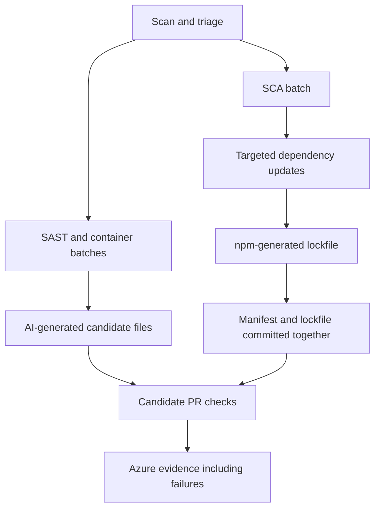

# NodeGoat npm dependency remediation

The NodeGoat fix workflow defaults to `ASVA_SCA_FIX_MODE=npm`.
Set the GitHub Actions repository variable of that name to `llm` to restore
the previous whole-file AI dependency fixes on subsequent runs. The application
source, deployment settings and PyGoat generation path are unchanged.

## Flow

1. Scan, normalise and triage as before.
2. For NodeGoat SCA batches, read `remediation.upgrade_to` from the findings.
   Use the recommended direct parent, not necessarily the vulnerable leaf package.
3. Apply exact stable release versions to existing dependencies, dev dependencies
   or optional dependencies. Keep the highest recommendation for each package;
   do not downgrade an already newer resolved or explicitly declared release.
   Unsupported versions, missing recommendations and non-direct upgrade targets
   are recorded as unresolved. ASVA does not invent overrides or new packages.
4. Copy the manifest and existing version-2 lockfile to temporary scratch space.
   Node 20.19.0 runs pinned npm 8.19.4 to generate a version-2 lockfile with
   `npm install --package-lock-only --ignore-scripts --no-audit --no-fund`.
   npm receives no GitHub/AI credentials and uses empty user/global configuration.
   The scanned checkout is not modified by generation.
5. Verify manifest declarations match the lockfile root and requested direct
   versions were resolved. Gate both files and commit the pair together in one
   SCA PR, or commit neither. Do not retry individual dependency files through AI.
6. Existing candidate checks evaluate installation, startup, functionality and
   applicable security checks. Candidate failures remain failures and are published.

The pinned generation toolchain is distinct from NodeGoat's existing runtime.
An upgrade incompatible with the application runtime must fail candidate checks;
successful lockfile generation does not establish application or security correctness.

## Version choice and test-first

Two steps run before the npm path and change what it receives:

- **Compatible versions** (`agent/safe_upgrades.py`). The scanner often recommends a new major
  version. Before any fix is generated, each finding's `remediation.upgrade_to` is replaced by
  the security-context service's compatible version, or cleared when there is none. The
  scanner's own value is kept in `remediation.scanner_upgrade_to`. If the service has no
  answer, only upgrades within the installed major version are kept.
- **Test before the PR** (`agent/test_first.py`, `ASVA_TEST_FIRST=1`). The safe candidate is
  built and tested; held-back upgrades are then tried one at a time and kept only if the app
  still works. Only what passed goes into the PR, and the PR says what was tried. When a
  passing major-version upgrade is kept, a second PR (`<batch_id>_same_major`) holds only the
  same-major upgrades. Both edit the same files, so the reviewer merges one of them.

## Evidence and failure handling

`prs.json` and the existing dashboard `fixes.json` retain a `generation` object for
the npm batch: method, npm version, requested upgrades, unresolved recommendations,
status, duration and diagnostic message. The PR body lists the upgrade plan.
Console output identifies the SCA mode and reports planned upgrade and unsupported
recommendation counts. Workflow labels use "candidate generation" because the
stage contains both AI and npm operations.

An npm failure or lack of supported upgrades produces no dependency PR, is recorded
explicitly and does not prevent other generated batches from being submitted.
There is no automatic fallback to a whole-lockfile AI call, merge, deployment,
memory update or automatic iteration. Future memory/RAG work can use the evidence
to inform later remediation plans and manually initiated runs.

## Validation and rollback

Tests cover isolated generation, credential exclusion, unsafe/unsupported upgrade
specifications, scoped package names, version selection, npm errors, lockfile
consistency, atomic Git submission/rejection, the LLM rollback route and preservation
of npm diagnostics through dashboard packaging. PR-comment tests distinguish delivery
success from failed candidate checks.

Switching the variable to `llm` restores the old generation path without deleting
candidate PRs or historical evidence. No generated dependency update is applied to the development
branch until a reviewer merges its candidate PR.

## Configuration

| Setting | Purpose | Workflow default |
|---|---|---|
| `ASVA_SCA_FIX_MODE` | Repository variable selecting `npm` or `llm` dependency generation | `npm` |
| `ASVA_NODEGOAT_OLLAMA_MODEL` | Repository variable selecting NodeGoat's AI model | `deepseek-v4.1-flash` |
| `ASVA_LLM_NUM_PREDICT` | Workflow environment setting for maximum AI output tokens | `65535` |

Changing SCA mode does not change the model. To compare with the older GLM path,
set both the mode and the NodeGoat model variable explicitly. PyGoat reads its own
workflow configuration. Generation uses Node 20.19.0/npm 8.19.4; it does not migrate
the application's existing Node runtime.

## Why npm generates the lockfile

Sending the whole dependency file to the LLM and asking for a complete replacement does not
work for NodeGoat: its lockfile is about 888 KB, which exceeds model input or output limits or
gets cut off mid-generation. Instead, ASVA applies the scanner's upgrade recommendations to the
manifest and lets npm regenerate the lockfile. The LLM still generates source-code and
container fixes. Each dependency PR carries the manifest and lockfile together.

## Known limitations

- Major upgrades can need matching application-code changes. In an early run, upgrading the
  MongoDB driver from 2.x to 3.x broke NodeGoat's database reset script
  (`db.dropCollection is not a function`); candidate validation caught it before review.
- Recommendations npm cannot apply stay unresolved, and registry failures can prevent
  generation.
- A passing candidate check does not show that every vulnerability is fixed.
